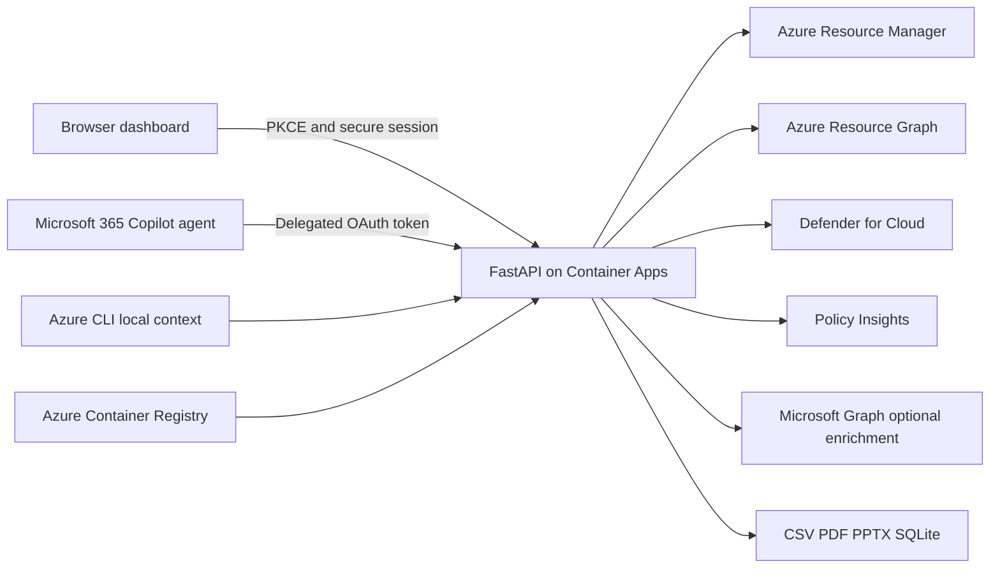

# Azure Security Posture Agent Deployment Plan

**Status:** Validated

## Objective

Create an independent, production-ready Azure Security Posture Assessment API, browser dashboard, export pipeline, Azure infrastructure definition, and Microsoft 365 Copilot declarative agent package. The service will collect only live data visible to the signed-in identity and will never execute remediation.

## Workspace Mode

- Mode: New project in an existing target directory.
- Target: `C:\Users\jerrywolff\Documents\.git\azure_security_posture_agent`.
- Reference only: `C:\Users\jerrywolff\Documents\.git\finops_ccoe_tracking` at commit `d531c1cedc56a253c1b09538e76b62e38516cce4`.
- Reference baseline: clean worktree when inspected.
- Constraint: Do not modify, import, merge, or deploy from the reference project.
- Existing target content: this plan only; preserve any user files encountered later.

## Reference Conventions

- FastAPI routes backed by Pydantic models and service-layer orchestration.
- Live Azure REST calls through `httpx`, domain-separated reporting, explicit source audits, and strict validation.
- HTML/CSS/vanilla JavaScript dashboard with tenant, subscription, filters, results, and exports.
- CSV, PDF, PowerPoint, and SQLite artifacts generated from normalized runtime results.
- PowerShell local bootstrap and Azure deployment runbooks.
- Practical README with local, Azure, testing, troubleshooting, and regeneration sections.
- FinOps domain logic, terminology, customer data, app identity, and resource names will not be copied.

## Requirements And Decisions

| Area | Decision |
| --- | --- |
| Runtime | Python 3.11+, FastAPI, Pydantic v2, `httpx`, Azure Identity/MSAL-compatible flows |
| Hosting | Azure Container Apps with external HTTPS ingress and Azure Container Registry |
| Infrastructure | Bicep plus generated ARM JSON for the requested deploy-button-compatible artifact |
| Browser auth | Entra authorization-code flow with PKCE; opaque secure HttpOnly session cookie; server-side token cache only |
| Local auth | Azure CLI token acquisition through `az account get-access-token`, scoped to the selected tenant |
| Copilot auth | Validate delegated bearer token claims and tenant context; use on-behalf-of acquisition only when configured and required |
| Tenant isolation | Explicit tenant selection, tenant claim validation, subscription ownership validation, and per-session runtime state |
| Data | Live Azure APIs only; no runtime mocks, samples, random values, or fallback findings |
| Persistence | No assessment cache or database service; latest assessment is in-memory session state; SQLite is export-only |
| Remediation | Text recommendations and deterministic command text only; no execution endpoints |
| Microsoft 365 | Separate declarative-agent manifest, definition, API plugin, OpenAPI contract, icons, and zip builder |
| Deployment execution | Generate and validate deployment artifacts only; do not create Azure resources in this preparation phase |

## Architecture

### Application Layers

1. `app/main.py` owns HTTP routes, safe session lookup, error translation, and download responses.
2. `app/auth.py` and `app/services/azure_auth.py` own token validation/acquisition and tenant-bound context.
3. Tenant/subscription services discover and validate explicit scope.
4. Domain collectors call read-only ARM, Resource Graph, Defender, Policy, Authorization, Monitor, and optional Graph APIs.
5. Evidence and enrichment services normalize identifiers, source metadata, query failures, and data quality.
6. Reporting and recommendation services consolidate findings without inventing values.
7. Exporters redact sensitive fields and create normalized CSV, PDF, PPTX, and SQLite output.
8. Static browser assets render scope, source freshness, findings, recommendations, evidence, errors, and export controls.

### Azure Resources

- Resource group: `rg-azure-security-posture-agent`.
- Container Apps environment: `sec-posture-env`.
- Container app: `azure-security-posture-agent`.
- Container registry with a globally unique generated name; image repository `azure-security-posture-agent`.
- Log Analytics workspace for Container Apps platform logs with authorization-header redaction in application logs.
- Optional system-assigned managed identity for ACR pull and platform operations only; it will not replace delegated user authorization for assessments.
- Entra app registration documented and parameterized separately as `Azure Security Posture Agent`; no secret is emitted or stored.

## Security Controls

- Read-only HTTP methods except tenant selection and assessment execution, both of which mutate only session/runtime state.
- Never bypass Azure RBAC or enumerate tenants/subscriptions outside the delegated identity.
- Validate issuer, audience, expiry, tenant claim, selected tenant, and subscription membership before collection.
- Never return access tokens to browser JavaScript or store them in local/session storage.
- Redact authorization, cookies, tokens, credentials, keys, connection strings, certificate material, and secret values from logs, responses, and exports.
- Collect Key Vault secret/certificate metadata only; never request values.
- Use structured partial failures so one permission-limited domain does not abort other collectors.
- Every finding requires evidence, tenant/subscription scope, source API, and observation timestamp.
- Strict validation rejects unsupported or ungrounded values and labels absent fields as `Not returned by source API`.
- CORS is allow-list based; production cookies are Secure, HttpOnly, and SameSite=Lax.
- Container runs as a non-root user and exposes only the application port.
- No client secrets, tokens, tenant IDs, or customer identifiers are committed.

## Implementation Steps

1. Create repository metadata, dependency lock surface, configuration, logging redaction, auth/session models, and structured errors.
2. Implement tenant/subscription discovery and tenant-bound Azure REST client behavior.
3. Implement reusable Resource Graph/ARM query helpers and the twelve requested domain collectors with live query logic and partial-failure handling.
4. Implement evidence, enrichment, normalization, risk rollup, and recommendations register.
5. Implement FastAPI browser/internal/Copilot endpoints and latest-assessment session state.
6. Implement the responsive browser dashboard and evidence drawer.
7. Implement redacted CSV, PDF, PPTX, and normalized SQLite exporters.
8. Create Dockerfile, local runbook, Container Apps deployment scripts, Bicep, generated ARM JSON, and example parameters.
9. Create the independent Microsoft 365 declarative-agent templates, plugin OpenAPI, icons, documentation, and package builder.
10. Add focused tests for API behavior, required evidence, redaction, no mock runtime data, exports, OpenAPI, package safety, and read-only boundaries.
11. Write the complete README and troubleshooting guidance.
12. Run compilation, tests, YAML validation, Bicep/ARM checks where tooling is available, package build, secret scan, git separation check, and reference worktree verification.

## Validation Gates

- `python -m py_compile app/main.py`.
- `python -m py_compile app/models.py`.
- `python -m pytest -q`.
- Parse the Copilot OpenAPI file as YAML and verify OpenAPI 3.x structure.
- Build the M365 zip with non-secret placeholder inputs and inspect its contents.
- Confirm export endpoints return 404 before a run.
- Confirm findings cannot validate without evidence.
- Confirm runtime collectors contain no mock/sample/random data paths.
- Confirm no endpoint executes remediation or Azure writes.
- Confirm `.gitignore` covers virtual environments, caches, artifacts, package output, environment files, local settings, Terraform state, and token caches.
- Confirm the target and reference are separate repositories/directories and the reference commit/worktree are unchanged.

## Deployment Flow

1. Run local bootstrap and tests.
2. Create a separate multi-tenant Entra app registration and expose/configure the API scopes and redirect URIs described in the README.
3. Run `deploy-azure.ps1` with explicit tenant, subscription, client ID, authority, location, and SKU parameters.
4. The script selects the subscription, creates the resource group, deploys Bicep resources, builds the image in ACR, updates Container Apps settings, and prints only safe outputs.
5. Configure the tenant-scoped Microsoft 365 OAuth reference outside source control.
6. Build `m365-agent/dist/azure-security-posture-agent.zip` using the deployed API URL and OAuth reference.
7. Validate and upload the package through Microsoft 365 Agents Toolkit or the approved tenant admin workflow.

## Approval Boundary

Approval of this plan authorizes local file generation and local validation only. It does not authorize Azure deployment, Entra app-registration creation, tenant configuration changes, or Microsoft 365 package upload.

## Role Assignment Verification

- Status: Verified.
- Identity checked: optional system-assigned identity on `azure-security-posture-agent`.
- Role confirmed: Azure Container Registry `AcrPull` (`7f951dda-4ed3-4680-a7ca-43fe172d538d`).
- Scope: project-specific Azure Container Registry only.
- Assessment authorization: no managed-identity assessment roles are assigned; live collection uses the signed-in user's delegated Azure RBAC boundary.
- Issues resolved: deterministic role-assignment name, conditional identity/registry configuration, and least-privilege registry scope.

## Validation Proof

| Check | Result |
| --- | --- |
| `python -m py_compile app/main.py` | Passed |
| `python -m py_compile app/models.py` | Passed |
| `python -m pytest -q` | Passed: 9 tests, no skips |
| VS Code diagnostics | Passed: no project errors |
| `az bicep build --file infra/main.bicep` | Passed with no template diagnostics; CLI upgrade notice only |
| ARM and parameters JSON parsing | Passed |
| Copilot OpenAPI YAML parsing | Passed |
| M365 package build and archive inspection | Passed; six expected files |
| PNG checksum and package icon validation | Passed |
| Runtime mock/static finding scan | Passed: no matches |
| Credential-literal scan | Passed: no suspicious committed values |
| Ignore-rule verification | Passed for virtual environments, package output, artifacts, environment files, local settings, Terraform state, and token caches |
| Reference repository integrity | Passed: clean at `d531c1cedc56a253c1b09538e76b62e38516cce4` |

No Azure deployment, Entra registration, tenant configuration, or Microsoft 365 upload was performed.
