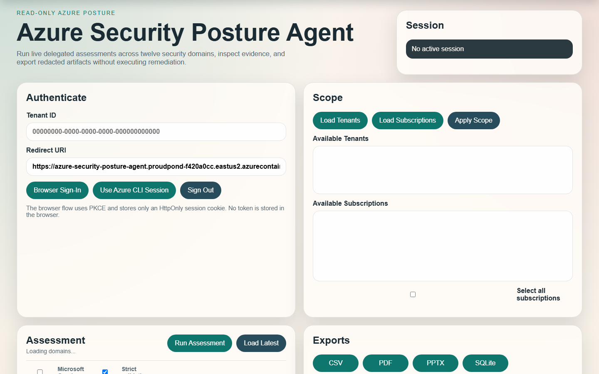
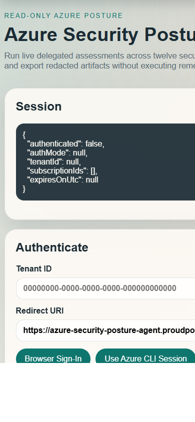
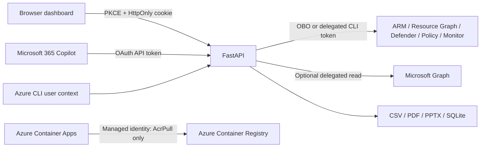

# Azure Security Posture Agent

[](https://github.com/jwgmpi-wolff/azure-security-posture-agent/actions/workflows/validate.yml)
[](https://github.com/jwgmpi-wolff/azure-security-posture-agent/actions/workflows/deploy-azure-m365.yml)
[](https://portal.azure.com/#create/Microsoft.Template/uri/https%3A%2F%2Fraw.githubusercontent.com%2Fjwgmpi-wolff%2Fazure-security-posture-agent%2Fmain%2Finfra%2Fazuredeploy.json)
[](#deploy-locally)

A live-data-only, read-only Azure security assessment service with a FastAPI API, responsive browser dashboard, evidence-backed exports, and a Microsoft 365 Copilot declarative agent. It uses the signed-in user's delegated Azure RBAC and never executes remediation.

## Screenshots

### Desktop dashboard



### Mobile dashboard



The screenshots show the safe pre-authentication state and contain no tenant or customer data.

## What It Does

- Discovers Azure tenants and subscriptions visible to the delegated identity.
- Assesses twelve security domains through live ARM, Resource Graph, Defender for Cloud, Policy Insights, Authorization, Monitor, and optional Microsoft Graph reads.
- Returns findings only when they include source metadata, observation time, evidence ID, and embedded evidence.
- Records permission limits and upstream failures as structured partial failures instead of clean results.
- Exports deterministic, redacted CSV, PDF, PowerPoint, and SQLite artifacts.
- Supports browser PKCE, local Azure CLI sessions, and Microsoft 365 Copilot OAuth with confidential-client OBO to ARM.
- Supports explicit cross-tenant context validation without relabeling or reusing a token from the wrong tenant.

## Security Boundaries

- Runtime Azure access is delegated to the signed-in user and constrained by actual Azure RBAC.
- A requested tenant must match the incoming token's `tid`. To assess another tenant, reconnect OAuth while signed in to that tenant.
- Subscription IDs are checked against live ARM subscription discovery before every bearer assessment.
- The Container App managed identity is used only to pull images from ACR.
- Tokens remain server-side and are never returned to browser JavaScript, logs, packages, or exports.
- No PUT, PATCH, DELETE, role assignment, policy mutation, or remediation execution is implemented.
- Missing, denied, unsupported, empty, and failed source states remain distinguishable.

## Architecture



## Repository Layout

| Path | Purpose |
| --- | --- |
| `app/` | API, auth, collectors, reporting, exporters, package builder, and static dashboard |
| `tests/` | Offline security, contract, export, package, and read-only boundary tests |
| `infra/` | Bicep plus ARM deploy-button template and safe example parameters |
| `m365-agent/` | Teams manifest, declarative agent, API plugin, OpenAPI, icons, and package builder |
| `.github/workflows/` | Validation and manual Azure/M365 package deployment workflows |
| `deploy-local.ps1` | Validated local setup and service startup |
| `deploy-azure.ps1` | Tenant-safe Azure deployment orchestration |
| `deploy-m365.ps1` | Deterministic M365 package build, validation, and delegated installation |

## Deploy Locally

### Prerequisites

- Windows PowerShell 7+
- Python 3.11+
- Azure CLI
- Git
- An Azure account with read access to the target scope

```powershell
git clone https://github.com/jwgmpi-wolff/azure-security-posture-agent.git
Set-Location azure-security-posture-agent
az login --allow-no-subscriptions
.\deploy-local.ps1
```

The script creates `.venv`, installs pinned dependencies, compiles the application, runs all tests, validates agent templates, prints only safe Azure CLI context, opens the browser, and starts the service at `http://127.0.0.1:8010`.

For a quick repeat run:

```powershell
.\deploy-local.ps1 -SkipInstall -SkipValidation
```

## Dashboard Workflow

1. Select **Use Azure CLI Session** to reuse the active delegated Azure CLI identity. The dashboard discovers the tenant from the issued token and loads the subscriptions visible to that identity.
2. Confirm the tenant and subscription scope. Scope changes remain bound to the authenticated token tenant.
3. Keep all twelve assessment domains selected or expand **Choose assessment domains** to narrow the run. Microsoft Graph enrichment is optional; strict validation remains enabled by default.
4. Select **Run Assessment**. A sticky operation indicator shows the active command, elapsed time, and temporarily disables conflicting actions.
5. Review severity and domain filters in **Findings**, select a row for its live evidence, and inspect **Coverage Gaps** for permission, provider, API-version, or upstream limitations.

Findings and recommendations render inside bounded, independently scrollable frames. Wide tables scroll horizontally within their panel instead of overlapping the Evidence view, while long result sets retain sticky headers and vertical scrolling. Domain names and common source failures are normalized for readability; expandable details preserve the underlying evidence without presenting collection failures as clean results.

## Deploy Azure And Build The M365 Package

### GitHub workflow button

Use **Deploy Azure + M365 package** at the top of this README. Configure the repository's `production` environment with:

- `AZURE_CREDENTIALS`: Azure Login JSON for a least-privilege deployment identity.
- `ENTRA_CLIENT_SECRET`: confidential-client secret used only for hosted OAuth OBO.

The workflow asks for the resource group, region, deployment tenant, subscription, multi-tenant Entra client ID, support email, and OAuth vault reference. It deploys Container Apps/ACR/monitoring, stores the OBO credential as a Container Apps secret reference, runs smoke checks, and uploads a validated six-file M365 package artifact.

GitHub-hosted runners do not install the package into Microsoft 365 because Agents Toolkit uses delegated interactive M365 login. Install the downloaded package from a trusted workstation.

### PowerShell deployment

Create the multi-tenant Entra registration first, expose `api://<client-id>/access_as_user`, add local and hosted callback URIs, and grant Azure Service Management delegated access. Then:

```powershell
$env:SECPA_ENTRA_CLIENT_SECRET = Read-Host "Entra OBO client secret" -MaskInput

.\deploy-azure.ps1 `
  -ResourceGroup "rg-azure-security-posture-agent" `
  -Location "eastus2" `
  -TenantId "<deployment-tenant-id>" `
  -SubscriptionId "<deployment-subscription-id>" `
  -EntraClientId "<multi-tenant-app-client-id>"
```

The process environment value is sent directly to Azure CLI, stored as `obo-client-secret`, and attached through `secretref:`. It is not written to source or printed.

## Install In Microsoft 365 Copilot

```powershell
npm install -g @microsoft/m365agentstoolkit-cli@beta
$env:ATK_CLI_SKILL = "true"
atk auth login m365 --tenant "<publishing-tenant-id>"

.\deploy-m365.ps1 `
  -ApiBaseUrl "https://<container-app-fqdn>" `
  -OAuthClientId "<multi-tenant-app-client-id>" `
  -ContactEmail "security@example.com" `
  -TenantIdOrDomain "organizations" `
  -OAuthReferenceId "azure-security-posture-oauth" `
  -Scope Personal `
  -Install
```

Use `organizations` for organizational accounts. Cross-tenant assessment still requires a token issued by the target tenant; changing `tenantId` in a prompt is never sufficient. The OAuth plugin vault reference must exist in the publishing tenant and match `OAuthReferenceId`.

Use `-Scope Shared` only after organizational review and approval.

## Deploy Button Scope

The ARM **Deploy to Azure** button provisions infrastructure only. It cannot build the repository image, create an Entra registration, configure an OAuth vault, or interactively install a Copilot agent. Use the GitHub workflow or PowerShell runbook for those authenticated steps.

## Copilot Authentication Context

1. `GET /api/copilot/auth-context` discovers the token tenant plus live authorized tenants and subscriptions.
2. `POST /api/copilot/auth-context` validates the selected tenant and subscription IDs.
3. Assessment operations run only after delegated scope validation.

If token tenant and requested tenant differ, the API returns `403` with instructions to reconnect plugin OAuth in the requested tenant. The service never substitutes managed identity or silently changes tenant ownership.

## API Surface

| Method and path | Purpose |
| --- | --- |
| `GET /api/health` | Safe application health contract |
| `GET /api/auth/context` | Browser/session metadata without tokens |
| `GET /api/tenants` | Cookie-session tenant discovery |
| `GET /api/subscriptions` | Cookie-session subscription discovery |
| `POST /api/assessment/run` | Cookie or bearer live read-only assessment |
| `GET /api/copilot/auth-context` | Copilot token tenant and scope discovery |
| `POST /api/copilot/auth-context` | Copilot tenant/subscription validation |
| `GET /api/copilot/assessment-summary` | Grounded summary |
| `GET /api/copilot/security-findings` | Filtered evidence-backed findings |
| `GET /api/copilot/recommendations` | Evidence-linked recommendations |
| `GET /api/export/{format}` | CSV, PDF, PPTX, or SQLite export |

## Validation

```powershell
python -m py_compile app\main.py app\models.py
python -m pytest -q
python -c "from pathlib import Path; import yaml; yaml.safe_load(Path('m365-agent/openapi.template.yaml').read_text(encoding='utf-8')); print('openapi-ok')"
az bicep build --file infra/main.bicep
```

## Operational Notes

- Sessions and the latest assessment are in memory and are cleared by process restart.
- The local Azure CLI flow invokes the resolved Windows CLI command directly, accepts an initially blank tenant selection, and uses the token `tid` and JWT expiry as authoritative session metadata.
- Provider registration, licensing, API version, and RBAC affect source coverage.
- Microsoft Graph enrichment is optional and permission-limited.
- The dashboard reports long-running commands visibly and keeps findings, recommendations, evidence, and coverage gaps within their owning frames on desktop and mobile layouts.
- Runtime collectors contain no sample findings, random counts, stale fallback rows, or fabricated clean results.
- Generated packages, exports, environments, token caches, `.env` files, and local Azure state are ignored by Git.

## Full Regeneration Prompt For GitHub Copilot

Paste this prompt into GitHub Copilot Agent Mode in an empty repository. Replace bracketed values only with real deployment values. Do not invent secrets, IDs, tenants, subscriptions, findings, or validation results.

<details>
<summary>Expand complete regeneration prompt</summary>

```text
Create a complete repository named azure-security-posture-agent. Work autonomously through implementation and offline validation, but do not deploy or modify cloud resources until explicitly authorized. Use Python 3.11, FastAPI, Uvicorn, Pydantic v2, pydantic-settings, httpx, JWT signature validation, MSAL-compatible OAuth, pytest, PyYAML, python-pptx, ReportLab, and SQLite. Target PowerShell 7 and Azure Container Apps.

PRODUCT
Build a production-oriented, live-data-only Azure security posture agent with a FastAPI API, responsive dashboard, delegated Azure authentication, Microsoft 365 Copilot declarative agent/API plugin, evidence-backed findings, redacted CSV/PDF/PPTX/SQLite exports, Bicep/ARM infrastructure, local/Azure/M365 deployment scripts, GitHub Actions, tests, and real desktop/mobile screenshots.

SECURITY RULES
- Assessments are read-only. Never implement control-plane PUT, PATCH, DELETE, remediation execution, role assignment, policy mutation, or secret retrieval.
- Runtime assessment access uses the signed-in user's delegated Azure RBAC. Managed identity is limited to ACR pull.
- Never expose access/refresh tokens, authorization headers, cookies, client secrets, keys, certificates, or connection strings in responses, browser storage, logs, packages, screenshots, or exports.
- Browser auth uses authorization code with PKCE and an opaque Secure/HttpOnly/SameSite cookie. Keep tokens server-side in memory.
- Copilot validates token signature, issuer, audience, expiry, and tenant, then uses confidential-client OAuth OBO for ARM. Never reuse the API token against ARM.
- Cross-tenant context is token-bound. A requested tenant must equal token tid. On mismatch return 403 instructing the user to reconnect OAuth in the requested tenant. Never relabel a token or substitute managed identity.
- Before every bearer assessment, enumerate live ARM subscriptions and reject IDs outside delegated access.
- Store hosted OBO credentials only as Container Apps secrets and secret references. Never commit or print them.
- Redact sensitive names and bearer/connection-string patterns before export or logging.

GROUNDING
- No mock runtime findings, sample rows, random risk values, fabricated clean results, or stale fallback analysis. Tests may have isolated fixtures.
- Every finding includes run, tenant, subscription, domain, severity, title, description, resource identity, source system/API, evidence ID, observed UTC, recommendation, non-executed remediation guidance, confidence, quality notes, and embedded evidence.
- Preserve denied, unavailable, unsupported, empty, failed, and partial states. Missing coverage is not healthy.
- Strict validation rejects ungrounded findings. Every recommendation traces to a finding/evidence ID.

DOMAINS AND SOURCES
Implement security overview; Defender for Cloud posture; Azure Policy/compliance; identity/access; management group/subscription governance; network; storage; Key Vault; compute/VM; AKS/container; logging/monitoring/evidence retention; recommendations register. Read live ARM tenants/subscriptions, Resource Graph, Microsoft.Security, Policy Insights, Authorization, Monitor/diagnostics, management groups, and optional Microsoft Graph. Centralize read-only HTTP, pagination, source API/version, timestamps, and partial failures.

MODELS AND API
Use snake_case Python and camelCase external contracts. Model tenant, subscription, principal/session, assessment request/result/metadata/summary, finding, evidence, recommendation, partial failure, API query log, export metadata, auth context, scope selection, and categorized errors.

Required routes:
GET /, /api/health, /api/config, /api/domains
GET /api/auth/context, /api/auth/session, /api/auth/browser/start, /api/auth/browser/callback
POST /api/auth/cli/session, /api/auth/logout
GET /api/tenants, /api/subscriptions; POST /api/tenant/select
POST /api/assessment/run and /api/assessments
GET /api/assessment/latest and /api/assessments/latest
GET /api/export/csv, /pdf, /pptx, /sqlite and /api/exports/{format}
GET and POST /api/copilot/auth-context
GET /api/copilot/assessment-summary, /security-findings, /recommendations

GET Copilot auth context returns tokenTenantId, selectedTenantId, discoverable tenants/subscriptions, source endpoints, and safe reauthentication guidance. POST validates tenant/subscriptions statelessly. POST assessment accepts cookie or bearer auth and does not persist ephemeral bearer sessions.

DASHBOARD
Create app/static/index.html, styles.css, app.js as the usable first screen. Include session status, tenant/redirect inputs, browser/CLI auth, tenant/subscription selection, twelve-domain controls, strict validation, run controls, exports, summary, findings, evidence, partial failures, recommendations, and status. Make it accessible and responsive at 390px and desktop widths. Never store tokens in JavaScript.

EXPORTS
CSV separates finding/recommendation records and serializes evidence deterministically. PDF includes scope, summary, findings, recommendations, evidence, and gaps. PPTX has exactly ten executive slides. SQLite normalizes assessment_runs, tenants, subscriptions, resources, findings, recommendations, evidence, api_query_log, export_artifacts. Return 404 before an assessment.

M365 PACKAGE
Create Teams manifest 1.19, declarative agent v1.0, API plugin v2.4, OpenAPI 3.0.x, icons, build-package.ps1, and deterministic Python builder. Zip exactly manifest.json, declarativeAgent.json, apiPlugin.json, openapi.yaml, color.png, outline.png. Use OAuthPluginVault and namespace azureSecurityPosture. Function names exactly equal operation IDs: getAuthContext, setAuthContext, getAssessmentSummary, getSecurityFindings, getRecommendations, runReadOnlyAssessment. Instructions call context discovery/validation before assessment and explain target-tenant OAuth reconnection. Include no secrets.

INFRASTRUCTURE AND DELIVERY
- Dockerfile starts Uvicorn on 8000 and avoids root where practical.
- Bicep deploys project-scoped Log Analytics, Application Insights, ACR, Container Apps environment/app, and AcrPull-only identity. Parameterize safe configuration.
- ARM JSON supports the Azure infrastructure deploy button.
- deploy-local.ps1 validates prerequisites, creates .venv, installs, compiles, tests, validates templates, prints safe CLI context, opens browser, and starts Uvicorn.
- deploy-azure.ps1 validates subscription/tenant context, deploys, verifies AcrPull, builds in ACR, updates Container Apps, optionally reads SECPA_ENTRA_CLIENT_SECRET into an Azure secret reference, and smoke-tests JSON health.
- deploy-m365.ps1 builds/validates and optionally performs delegated atk install for Personal/Shared scope. Never claim a headless runner completed interactive M365 login.
- Add validate.yml and a manual deploy-azure-m365.yml using azure/login, production secrets AZURE_CREDENTIALS/ENTRA_CLIENT_SECRET, Azure deployment, M365 package artifact upload.

README
Include capabilities, security boundaries, Mermaid architecture, real safe screenshots, local setup, workflow/ARM/local buttons, M365 install, cross-tenant behavior, API, validation, troubleshooting, limitations, and this full regeneration prompt. Explain each deploy button's boundary.

TESTS
Test evidence, no runtime mocks, redaction, read-only HTTP, config parsing, export preconditions, ten PPTX slides, SQLite tables, exact package set/schema/function IDs, no secrets, token tenant extraction, wrong-tenant rejection, auth context discovery, denied subscription, and bearer assessment POST.
Run py_compile and full pytest. Parse JSON/YAML/PowerShell. Build and inspect a safe sample package. Build Bicep when available. Do not report cloud success without real smoke checks. Capture unauthenticated desktop/mobile screenshots.

GIT
Ignore environments, caches, exports, generated packages, .env, token caches, local Azure/Terraform state, and secrets. Publish no customer data or unrelated files. Finish with changed files, exact validation evidence, deployment status, and remaining interactive steps. Never fabricate success.
```

</details>

## License

No license has been granted by this repository. Add an approved license before third-party redistribution.
